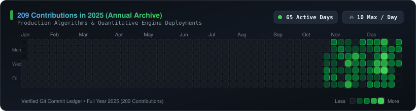

  <h1>Hi, I'm Sabeeh Ahmad </h1>

  

  

    <strong>📍 Bangalore, India</strong> &nbsp;•&nbsp;
    <a href="https://sabeeh.in">🌐 <strong>sabeeh.in</strong></a> &nbsp;•&nbsp;
    <a href="mailto:Lemontree7981@gmail.com">✉️ <strong>Lemontree7981@gmail.com</strong></a>
  

  

    
    
    
  

 

> **I turn complex market data into deterministic decisions.**  
> Focused on systematic intraday trading engines, stochastic Monte Carlo wealth simulators, and production data pipelines. I engineer systems where quantitative rigor meets low-latency, 24/7 cloud execution.

 

  <table border="0" cellspacing="0" cellpadding="0">
    <tr>
      <td align="center" width="180">
        <h3>🚀 6+</h3>
        
<b>Shipped Products</b>

      </td>
      <td align="center" width="180">
        <h3>⚡ 24/7</h3>
        
<b>Cloud Daemon Uptime</b>

      </td>
      <td align="center" width="180">
        <h3>☁️ OCI & GCP</h3>
        
<b>Cloud Deployments</b>

      </td>
      <td align="center" width="180">
        <h3>📈 NSE</h3>
        
<b>Intraday Microstructure</b>

      </td>
    </tr>
  </table>

---

## 🛠️ Technical Stack & Domain Expertise

#### Quantitative Finance & Trading Systems

  
  
  
  
  

#### Data Engineering, Analytics & Modeling

  
  
  
  
  
  

#### Cloud, Systems & Deployment

  
  
  
  
  
  

---

## 🚀 Featured Engineering Systems

<table>
  <tr>
    <td width="100%">
      <h3>📈 <a href="https://sabeeh.in/blog/ict-algo-trading-engine">Quantitative ICT Intraday Trading Engine (NSE)</a></h3>
      
<em>Autonomous systematic algorithmic execution engine engineered for benchmark National Stock Exchange (NSE) high-beta equities (BAJAJFINSV, DIVISLAB, JUBLFOOD).</em>

      <ul>
        <li><strong>Microstructure Exploitation:</strong> Real-time detection of liquidity sweeps, 1.30x institutional displacement filters, and fair value gap (FVG) retests.</li>
        <li><strong>Execution & Capital Protection:</strong> Intrabar LTP exit triggers, strict 2.25:1 profit-to-risk ratio, and concurrency locking across multi-asset portfolios.</li>
        <li><strong>Production Infrastructure:</strong> Running 24/7 as an autonomous Linux system daemon on Oracle Cloud Infrastructure (OCI) with zero human intervention.</li>
      </ul>
      

        
        
        
        
        
      

      

        <a href="https://sabeeh.in/blog/ict-algo-trading-engine"><strong>Read Architecture Case Study ↗</strong></a>
      

    </td>
  </tr>
</table>

<table>
  <tr>
    <td width="100%">
      <h3>🎲 <a href="https://finance.sabeeh.in">finTWIN — AI Financial Digital Twin</a></h3>
      
<em>High-fidelity, client-side Monte Carlo wealth engine and stochastic simulator.</em>

      <ul>
        <li><strong>Stochastic Modeling:</strong> Simulates multi-decade wealth trajectories under varying market regimes, inflation shocks, and asset return distributions.</li>
        <li><strong>Real-Time Analytics:</strong> Computes probabilistic percentile bands (10th, 50th, 90th percentiles) and delivers interactive financial health scoring rendered smoothly on HTML5 Canvas.</li>
      </ul>
      

        
        
        
        
      

      

        <a href="https://finance.sabeeh.in"><strong>Launch Live App ↗</strong></a> &nbsp;•&nbsp;
        <a href="https://sabeeh.in/blog/fintwin-ai-financial-twin"><strong>Read Architecture Case Study ↗</strong></a>
      

    </td>
  </tr>
</table>

<table>
  <tr>
    <td width="100%">
      <h3>📊 <a href="https://dashboard.sabeeh.in">Fintech Churn Intelligence Dashboard</a></h3>
      
<em>Real-time churn risk detection platform built for early-stage Indian neobanks.</em>

      <ul>
        <li><strong>Behavioral Signals:</strong> Surfaces churn vulnerabilities using UPI transaction frequency, early balance depletion rates, and inactivity windows combined with CIBIL score brackets.</li>
        <li><strong>Targeted Interventions:</strong> Automatically isolates high-value, at-risk cohorts (e.g. 74 users with early inactivity warnings but strong CIBIL > 650) to inform proactive retention campaigns.</li>
      </ul>
      

        
        
        
        
        
      

      

        <a href="https://dashboard.sabeeh.in"><strong>Explore Live Dashboard ↗</strong></a> &nbsp;•&nbsp;
        <a href="https://sabeeh.in/churn-dashboard"><strong>View Case Study ↗</strong></a>
      

    </td>
  </tr>
</table>

<table>
  <tr>
    <td width="100%">
      <h3>🔬 <a href="https://github.com/Lemontree7981/StressMonitoring">BioSense — AI Diagnostics API</a></h3>
      
<em>Medical image classification pipeline with Grad-CAM explainability for clinical interpretability.</em>

      <ul>
        <li><strong>Serverless Scale:</strong> Containerized with Docker and deployed serverless on Google Cloud Platform (Cloud Run) for low-latency REST inference.</li>
        <li><strong>Explainable AI:</strong> Integrates Grad-CAM visual heatmaps overlaying diagnostic attention regions to provide transparent model decisions.</li>
      </ul>
      

        
        
        
        
      

      

        <a href="https://github.com/Lemontree7981/StressMonitoring"><strong>View Repository ↗</strong></a>
      

    </td>
  </tr>
</table>

<table>
  <tr>
    <td width="100%">
      <h3>⚡ <a href="https://github.com/Lemontree7981/File-Splitter">File Splitter CLI</a></h3>
      
<em>Minimalist Python command-line utility for chunking and reconstructing massive datasets.</em>

      <ul>
        <li>Zero third-party dependencies, built for streaming large files across memory-constrained environments with SHA validation.</li>
      </ul>
      

        
        
        
      

      

        <a href="https://github.com/Lemontree7981/File-Splitter"><strong>View Repository ↗</strong></a>
      

    </td>
  </tr>
</table>

---

## 📝 Technical Writing & Architecture Deep Dives

I document quantitative system design, execution mechanics, and stochastic modeling architectures:

| Architecture Case Study | Focus Domain | Direct Link |
|:---|:---|:---:|
| **Autonomous ICT Intraday Algorithmic Trading Architecture** | Market Microstructure, Liquidity Sweeps & Execution | [Read Case Study ↗](https://sabeeh.in/blog/ict-algo-trading-engine) |
| **finTWIN: Client-Side Monte Carlo Wealth Simulation Engine** | Stochastic Modeling & Real-Time Distributions | [Read Case Study ↗](https://sabeeh.in/blog/fintwin-ai-financial-twin) |
| **Neobank Churn Intelligence & UPI Behavior Signals** | Behavioral Feature Engineering & Churn Risk Cohorts | [View Analysis ↗](https://sabeeh.in/churn-dashboard) |

👉 *Read all architectural breakdowns and research notes at [sabeeh.in/blog](https://sabeeh.in/blog).*

---

## 📊 GitHub Analytics & Engineering Activity

  <!-- Custom FinTech Styled 2025 Contribution Calendar Archive -->
  

    

  <table border="0" cellpadding="0" cellspacing="0">
    <tr>
      <!-- 2026 Engineering Velocity Card -->
      <td align="center" valign="middle" width="380">
        <table border="0" cellpadding="10" cellspacing="0" width="100%">
          <tr>
            <td align="center">
              <h3>⚡ 2026 Engineering Velocity</h3>
              

                
              

              

                
              

              

                
              

              

                <i>Active daily commits across quantitative engines & data systems</i>
              

            </td>
          </tr>
        </table>
      </td>
      <!-- Top Languages Card -->
      <td align="center" valign="middle" width="380">
        
      </td>
    </tr>
  </table>

---

## 🤝 Let's Connect

  
Open to quantitative finance roles, fintech engineering collaborations, and research discussions.

  

    
    
    
  

   
  
<i>Deterministic rules. Clean execution pipelines. Production reliability.</i>

